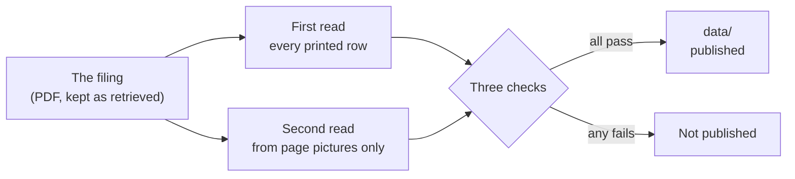
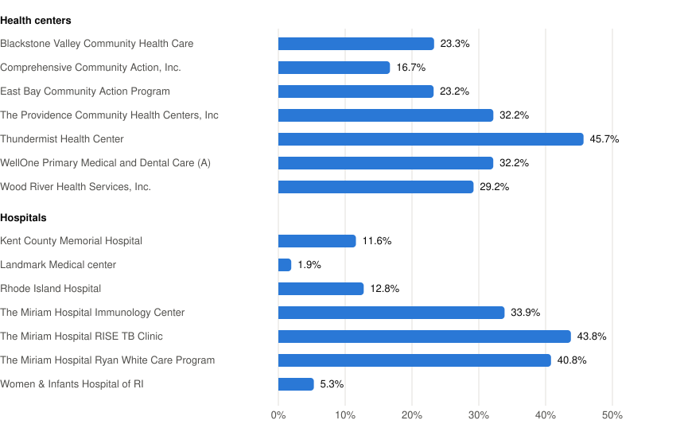

<p>
  <a href="https://clinx.org">
    <picture>
      <source media="(prefers-color-scheme: dark)" srcset="https://raw.githubusercontent.com/VVillBerchtold/clinx-org/main/public/brand/clinx-wordmark-on-dark.svg">
      
    </picture>
  </a>
</p>

# clinx-340b: state 340B filings and laws as open data

Some states now require hospitals and health centers in the federal 340B drug program to report, each year, what the program cost them, what it paid them, and whom they paid along the way. The reports are public, but they are PDF files, one per filer, and hard to read side by side.

This repository turns them into one open dataset that anyone can open in a spreadsheet. Three things make it worth trusting:

- **Every figure is kept exactly as printed.** Nothing is corrected, rounded or estimated.
- **Every figure names the page of the PDF it was read from**, and the PDFs are kept here too.
- **Anyone can rebuild the published files with one command** and get the same files, byte for byte, and can repeat every check behind them.

## What is in it

| State | What was read | Year |
|---|---|---|
| **Rhode Island** | The 14 filings on state Form RIOAG-340B (seven health centers, seven hospital filings), under R.I. Gen. Laws § 5-19.3-6 | Calendar 2025 |
| **Vermont** | The 13 hospital reports to the Green Mountain Care Board, each a one-page "340B Program Financial Reporting Detail" that the page itself marks as draft | Fiscal 2025 |
| **Minnesota** | Two tables from the Department of Health's report to the legislature under Minn. Stat. 62J.461, *340B Covered Entity Report, 2025* (cover date February 27, 2026): one row for each of the 26 entities it names, and six totals | Calendar 2024 |
| **Idaho** | The State Controller's statewide report under Idaho Code § 41-351, *Idaho 340B Drug Pricing Program, Inaugural Report, Calendar Year 2025*: every table of totals it prints, for 62 covered entities added together. It names no entity | Calendar 2025 |
| **Maine** | The Maine Health Data Organization's first report under Title 22, § 1728 of the Maine statutes, *1st Annual 340B Drug Program Transparency Report* (2 April 2026): every total and both tables of drugs it prints, for 27 hospitals added together. It names no hospital's figures | Fiscal 2024 |
| **Minnesota, earlier year** | The same Department's earlier report, *340B Covered Entity Report* (25 November 2024): Appendix Tables 5 and 6, one row for each of the 26 entities Table 5 names, and the Table 6 totals by grouping and payer. An entity named in both years is one entity with two records | Calendar 2023 |

Four notes on reading across states:

- **Minnesota's rows are the State's published figures about those entities, one figure each. They are not the entities' own filings, which are not public.** The report itself says the reported data "are not audited nor otherwise verifiable". `record_kind` in `data/filings.csv` tells an entity's own filing (Rhode Island, Vermont) from a row the State published about an entity (Minnesota).
- **Idaho's record is statewide totals only.** Idaho's law keeps each entity's filing confidential and has the State Controller publish the figures added together. The dataset holds that report as one record (`record_kind` is `state_report_totals`), with a row for every cell the report prints. It has no row for any single covered entity.
- **Maine's record is statewide totals only.** The report gives each figure for the 27 hospitals added together and names the hospitals only in the descriptions of what their savings fund. The dataset holds it as one record (`record_kind` is `state_report_totals`). The hospital descriptions are text and are listed as an attachment, not transcribed; the 27 hospital names are kept in that attachment's note. The report prints its dollar totals rounded to a tenth of a million, so those two are kept as printed text and not as numbers.
- The states use different forms, so each record names its own. Rhode Island's rows keep the schedule letters and line numbers the form prints. Vermont's page, Minnesota's tables, Idaho's report and Maine's report print none, so their rows carry short keys assigned by this dataset, beside the label as printed. Vermont's separate narratives are listed as attachments and not transcribed.

## State laws about 340B (new in 0.6.0)

Beside the filings, the dataset now lists the state laws that name the 340B program: 73 laws in 38 states, each one read on the state's own website.

| File | What it is |
|---|---|
| [`state-laws.csv`](data/state-laws.csv) | One row per enacted law: its kinds, citation, bill, dates, who it binds, what it does, its limits, how it is enforced, a sentence quoted from the law, and the link to the official page |
| [`state-laws-not-listed.csv`](data/state-laws-not-listed.csv) | Laws that came up in the search and are not in the table, each with the reason |
| [`340b-state-laws.json`](data/340b-state-laws.json) | Both, with the list of kinds, in one document |

How to read it:

- **A law is listed only if its official text names 340B**, or cites the program's section of federal law, 42 U.S.C. 256b. The text of each official page is saved in [`sources/laws/`](sources/laws/), and the sentence quoted in each row is in that saved text word for word. The build stops if it is not.
- **Every link goes to a legislature's or a state office's own site.** [`laws/hosts.csv`](laws/hosts.csv) lists them. No row was taken from a tracker or from someone else's summary.
- **A blank means the official page does not print it.** A signing date, an effective date, a bill number or an act number is filled only where a saved page prints it. Montana's code, for one, prints the chapter of an act and not its bill number.
- **Each law has one or more of seven kinds**: contract pharmacy access, payer and PBM non-discrimination, reporting, Medicaid, use of savings, study, and other. [`laws/kinds.csv`](laws/kinds.csv) says what each means.
- **No row for a state means none was found, not that none exists.** Nothing was found for Alabama, Alaska, the District of Columbia, Florida, Georgia, Kansas, Massachusetts, New Jersey, New York, South Carolina, Texas, Wisconsin or Wyoming. Georgia, Kansas and New York have entries in the not-listed file. If you know of a law that is missing, open an issue with the link to the state's page.
- **It is a list of what was enacted.** It does not follow court cases about these laws, bills that have not passed, or how a law is enforced in practice. The summaries are plain-words descriptions; the law's own text is the record. None of it is legal advice.

[METHODS.md](METHODS.md) section 10 says how each law was found, read and checked.

## Open the data

Everything published is in [`data/`](data/), as CSV files and two JSON files. For the filings, start with these four:

| File | What it is |
|---|---|
| [`filings.csv`](data/filings.csv) | One row per filing or report |
| [`line_items.csv`](data/line_items.csv) | Every row of every filing, each with its page number and its unit |
| [`measures.csv`](data/measures.csv) | The few calculated measures, each with the lines it was worked out from |
| [`discrepancies.csv`](data/discrepancies.csv) | Every place a filing's own figures do not agree with each other |

[DATA_DICTIONARY.md](DATA_DICTIONARY.md) describes each column. [METHODS.md](METHODS.md) says how every figure was read, checked and calculated.

## How a figure gets from a PDF into the dataset



A row is published only after three separate checks. The build refuses a row that has not passed them.

1. **The PDF's own text.** Is every transcribed figure printed on the page it cites? Is every figure on the page carried by a row? The first question catches a mistyped figure; the second catches a row left out.
2. **A second, separate read.** A second reader is given only pictures of the pages, with no sight of the PDF's text or of the first read, and writes down every figure it sees. A row counts as checked only when the two reads agree, figure for figure.
3. **The form's own sums.** Where a form says one line is the sum of others, the sum is run.

Both reads are made by software, each as a separate job; [METHODS.md](METHODS.md) section 3 says exactly how, and what the limits are. The PDFs, both reads and the code are all here, so anyone can repeat every check.

How it came out: the two reads agreed on every one of Rhode Island's 2,989 rows, Vermont's 157, Minnesota's 70 and Idaho's 105. Where a filing's own figures do not add up, that is the filing's, and it is listed in `discrepancies.csv`, not fixed.

## What the dataset will and will not do

- A filed figure is never changed. Where a filing's, or a state report's, figures do not agree with each other, both are kept and the difference is listed.
- Minnesota's rows are not ranked. The report prints its table in an order; nothing here treats a row as a place in an order.
- A vendor's name is normalized in a separate column. The name as filed is always kept beside it.
- A page that cannot be read with confidence is left blank and marked. No value is estimated.
- The dataset describes what was filed and how each measure is calculated. It does not say why a filer's figures are what they are.
- It holds no patient data. The filings are entity-level public records.
- A claim count of 1 to 5 is not republished. The reader sees `fewer_than_6` in its place, in every table file in this repository. The filing's PDF still prints the count. See [METHODS.md](METHODS.md) section 9.

## One finding (Rhode Island)

In their 2025 filings, Rhode Island's seven health centers together reported a 340B gross margin of $47.8 million, and reported paying $17.6 million of it, 36.8%, to contract pharmacies and outside vendors. The seven hospital filings together reported 12.9%.

<picture>
  <source media="(prefers-color-scheme: dark)" srcset="data/external-share-dark.svg">
  
</picture>

How the share is calculated: Schedule A lines 3 and 4 (payments to contract pharmacies and to outside vendors) added together, divided by line 2 minus line 1 (payments received minus acquisition cost).

The finding and the chart are Rhode Island's. Vermont's measures, worked the same way on Vermont's rows, are in [`data/measures.csv`](data/measures.csv). Minnesota has no measures: its tables print no acquisition cost and no payments to pharmacies or vendors. Idaho and Maine have none either: each has one record that is a statewide total, and the measures compare covered entities.

Read it with care. A filer that runs its own pharmacy carries that cost in its own expenses, and a filer that relies on contract pharmacies pays it out on line 3, so two filers' shares are not directly comparable. Line 3 counts every pharmacy a filer lists on Schedule D, whoever owns it. The filings are listed alphabetically; nothing here is a ranking. See [METHODS.md](METHODS.md).

## A map of the folders

| Folder | What it holds |
|---|---|
| `sources/` | The PDFs as retrieved, each with its address, the time it was retrieved and a fingerprint (SHA-256), and the text each PDF carries |
| `transcriptions/` | The first read: one file per filing, every printed row with its page number and how it was checked |
| `verification/` | The second read, made from the page pictures |
| `reference/` | Normalized vendor names, spending categories, and a note for every difference found in a filing |
| `laws/` | The table of state laws, kept by hand: the laws, the seven kinds, the official sites, and the laws not listed |
| `sources/laws/` | The text of each law's official page, as saved on the day it was read |
| `data/` | The published dataset. Rebuilt from the folders above; never edited by hand |
| `src/`, `tests/`, `tools/` | The code that checks and builds the dataset |

## Rebuild and check it yourself

You need [uv](https://docs.astral.sh/uv/) and Python 3.12.

Install it:

```bash
uv sync --locked
```

Rebuild `data/`, then confirm the files in the repository are byte for byte what the build gives:

```bash
uv run filings340b build
```

```bash
uv run filings340b check
```

| Command | What it shows |
|---|---|
| `uv run filings340b build` | Rewrites `data/` from the archived sources and the checked transcriptions |
| `uv run filings340b check` | Confirms the committed `data/` is exactly what a fresh build produces |
| `uv run filings340b textcheck` | Compares every transcribed figure with the text of its PDF page |
| `uv run filings340b tieout` | Runs the sums of each filing's own form |
| `uv run pytest` | Runs the tests |

One thing you will see: each check prints a line saying it ran "without the private small counts". That is expected. The claim counts of 1 to 5 are kept out of this repository, so a clone checks everything else and takes the sums that depend on them from a small results file. The published files come out the same either way. [METHODS.md](METHODS.md) section 9 explains it.

## Corrections

If a figure here does not match the filing it cites, please open an issue that names the filing, the schedule and the line. The PDF governs.

[CONTRIBUTING.md](CONTRIBUTING.md) says how to report a wrong figure and how to add another state or year. [CHANGELOG.md](CHANGELOG.md) lists what changed in each version.

## The rest of the project

| Repository | What it is |
|---|---|
| clinx-340b (you are here) | The dataset |
| [clinx-radar](https://github.com/VVillBerchtold/clinx-radar) | A small tool that reports what changed in the federal 340B registry |
| [clinx-org](https://github.com/VVillBerchtold/clinx-org) | The website, [clinx.org](https://clinx.org), which shows this dataset and never changes a figure |

## Licence

The code is under the [MIT licence](LICENSE). The dataset in `data/`, `transcriptions/`, `verification/` and `reference/` is under [Creative Commons Attribution 4.0](LICENSE-DATA). The PDF filings in `sources/` are public records of the State of Rhode Island, of the State of Vermont (the Green Mountain Care Board) of the State of Minnesota (the Department of Health) and of the State of Idaho (the State Controller's Office), reproduced unchanged.
