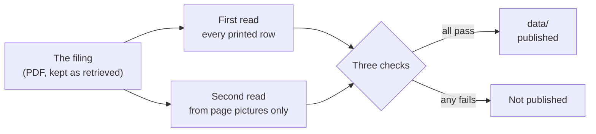
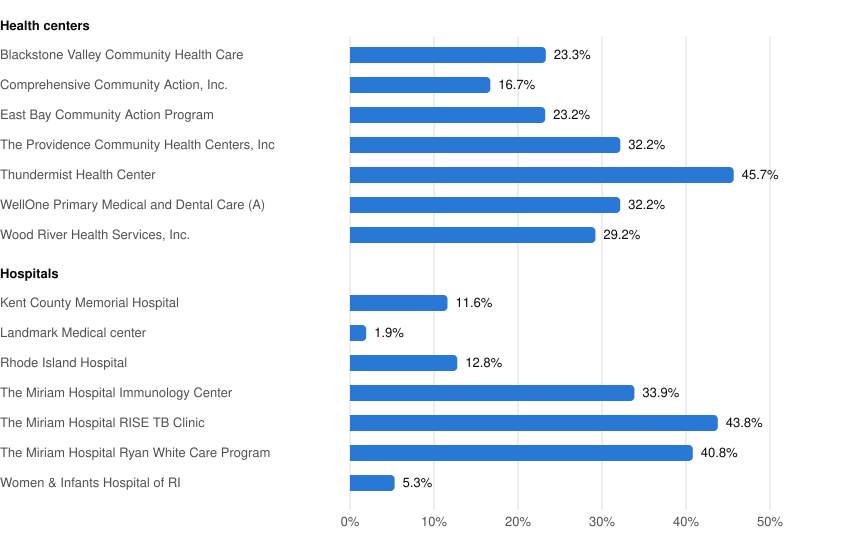

<p>
  <a href="https://clinx.org">
    <picture>
      <source media="(prefers-color-scheme: dark)" srcset="https://raw.githubusercontent.com/VVillBerchtold/clinx-org/main/public/brand/clinx-wordmark-on-dark.svg">
      
    </picture>
  </a>
</p>

# clinx-340b: state 340B filings as open data

Some states now require hospitals and health centers in the federal 340B drug program to report, each year, what the program cost them, what it paid them, and whom they paid along the way. The reports are public, but they are PDF files, one per filer, and hard to read side by side.

This repository turns them into one open dataset that anyone can open in a spreadsheet. Three things make it worth trusting:

- **Every figure is kept exactly as printed.** Nothing is corrected, rounded or estimated.
- **Every figure names the page of the PDF it was read from**, and the PDFs are kept here too.
- **Anyone can rebuild the published files with one command** and get the same files, byte for byte, and can repeat every check behind them.

## What is in it

| State | What was read | Year |
|---|---|---|
| **Rhode Island** | The 14 filings on state Form RIOAG-340B (seven health centers, seven hospital filings), under R.I. Gen. Laws § 5-19.3-6 | Calendar 2025 |
| **Vermont** | The 13 hospital reports to the Green Mountain Care Board, each a one-page "340B Program Financial Reporting Detail" that the page itself marks as draft | Fiscal 2025 |
| **Minnesota** | Two tables from the Department of Health's report to the legislature under Minn. Stat. 62J.461, *340B Covered Entity Report, 2025* (cover date February 27, 2026): one row for each of the 26 entities it names, and six totals | Calendar 2024 |

Two notes on reading across states:

- **Minnesota's rows are the State's published figures about those entities, one figure each. They are not the entities' own filings, which are not public.** The report itself says the reported data "are not audited nor otherwise verifiable". `record_kind` in `data/filings.csv` tells an entity's own filing (Rhode Island, Vermont) from a row the State published about an entity (Minnesota).
- The states use different forms, so each record names its own. Rhode Island's rows keep the schedule letters and line numbers the form prints. Vermont's page and Minnesota's tables print none, so their rows carry short keys assigned by this dataset, beside the label as printed. Vermont's separate narratives are listed as attachments and not transcribed.

## Open the data

Everything published is in [`data/`](data/), as CSV files and one JSON file. Start with these four:

| File | What it is |
|---|---|
| [`filings.csv`](data/filings.csv) | One row per filing or report |
| [`line_items.csv`](data/line_items.csv) | Every row of every filing, each with its page number and its unit |
| [`measures.csv`](data/measures.csv) | The few calculated measures, each with the lines it was worked out from |
| [`discrepancies.csv`](data/discrepancies.csv) | Every place a filing's own figures do not agree with each other |

[DATA_DICTIONARY.md](DATA_DICTIONARY.md) describes each column. [METHODS.md](METHODS.md) says how every figure was read, checked and calculated.

## How a figure gets from a PDF into the dataset



A row is published only after three separate checks. The build refuses a row that has not passed them.

1. **The PDF's own text.** Is every transcribed figure printed on the page it cites? Is every figure on the page carried by a row? The first question catches a mistyped figure; the second catches a row left out.
2. **A second, separate read.** A second reader is given only pictures of the pages, with no sight of the PDF's text or of the first read, and writes down every figure it sees. A row counts as checked only when the two reads agree, figure for figure.
3. **The form's own sums.** Where a form says one line is the sum of others, the sum is run.

Both reads are made by software, each as a separate job; [METHODS.md](METHODS.md) section 3 says exactly how, and what the limits are. The PDFs, both reads and the code are all here, so anyone can repeat every check.

How it came out: the two reads agreed on every one of Rhode Island's 2,989 rows, Vermont's 157 and Minnesota's 70. Where a filing's own figures do not add up, that is the filing's, and it is listed in `discrepancies.csv`, not fixed.

## What the dataset will and will not do

- A filed figure is never changed. Where a filing's, or the Minnesota report's, figures do not agree with each other, both are kept and the difference is listed.
- Minnesota's rows are not ranked. The report prints its table in an order; nothing here treats a row as a place in an order.
- A vendor's name is normalized in a separate column. The name as filed is always kept beside it.
- A page that cannot be read with confidence is left blank and marked. No value is estimated.
- The dataset describes what was filed and how each measure is calculated. It does not say why a filer's figures are what they are.
- It holds no patient data. The filings are entity-level public records.
- A claim count of 1 to 5 is not republished. The reader sees `fewer_than_6` in its place, in every table file in this repository. The filing's PDF still prints the count. See [METHODS.md](METHODS.md) section 9.

## One finding (Rhode Island)

In their 2025 filings, Rhode Island's seven health centers together reported a 340B gross margin of $47.8 million, and reported paying $17.6 million of it, 36.8%, to contract pharmacies and outside vendors. The seven hospital filings together reported 12.9%.

<picture>
  <source media="(prefers-color-scheme: dark)" srcset="data/external-share-dark.svg">
  
</picture>

How the share is calculated: Schedule A lines 3 and 4 (payments to contract pharmacies and to outside vendors) added together, divided by line 2 minus line 1 (payments received minus acquisition cost).

The finding and the chart are Rhode Island's. Vermont's measures, worked the same way on Vermont's rows, are in [`data/measures.csv`](data/measures.csv). Minnesota has no measures: its tables print no acquisition cost and no payments to pharmacies or vendors.

Read it with care. A filer that runs its own pharmacy carries that cost in its own expenses, and a filer that relies on contract pharmacies pays it out on line 3, so two filers' shares are not directly comparable. Line 3 counts every pharmacy a filer lists on Schedule D, whoever owns it. The filings are listed alphabetically; nothing here is a ranking. See [METHODS.md](METHODS.md).

## A map of the folders

| Folder | What it holds |
|---|---|
| `sources/` | The PDFs as retrieved, each with its address, the time it was retrieved and a fingerprint (SHA-256), and the text each PDF carries |
| `transcriptions/` | The first read: one file per filing, every printed row with its page number and how it was checked |
| `verification/` | The second read, made from the page pictures |
| `reference/` | Normalized vendor names, spending categories, and a note for every difference found in a filing |
| `data/` | The published dataset. Rebuilt from the folders above; never edited by hand |
| `src/`, `tests/`, `tools/` | The code that checks and builds the dataset |

## Rebuild and check it yourself

You need [uv](https://docs.astral.sh/uv/) and Python 3.12.

Install it:

```bash
uv sync --locked
```

Rebuild `data/`, then confirm the files in the repository are byte for byte what the build gives:

```bash
uv run filings340b build
```

```bash
uv run filings340b check
```

| Command | What it shows |
|---|---|
| `uv run filings340b build` | Rewrites `data/` from the archived sources and the checked transcriptions |
| `uv run filings340b check` | Confirms the committed `data/` is exactly what a fresh build produces |
| `uv run filings340b textcheck` | Compares every transcribed figure with the text of its PDF page |
| `uv run filings340b tieout` | Runs the sums of each filing's own form |
| `uv run pytest` | Runs the tests |

One thing you will see: each check prints a line saying it ran "without the private small counts". That is expected. The claim counts of 1 to 5 are kept out of this repository, so a clone checks everything else and takes the sums that depend on them from a small results file. The published files come out the same either way. [METHODS.md](METHODS.md) section 9 explains it.

## Corrections

If a figure here does not match the filing it cites, please open an issue that names the filing, the schedule and the line. The PDF governs.

[CONTRIBUTING.md](CONTRIBUTING.md) says how to report a wrong figure and how to add another state or year. [CHANGELOG.md](CHANGELOG.md) lists what changed in each version.

## The rest of the project

| Repository | What it is |
|---|---|
| clinx-340b (you are here) | The dataset |
| [clinx-radar](https://github.com/VVillBerchtold/clinx-radar) | A small tool that reports what changed in the federal 340B registry |
| [clinx-org](https://github.com/VVillBerchtold/clinx-org) | The website, [clinx.org](https://clinx.org), which shows this dataset and never changes a figure |

## Licence

The code is under the [MIT licence](LICENSE). The dataset in `data/`, `transcriptions/`, `verification/` and `reference/` is under [Creative Commons Attribution 4.0](LICENSE-DATA). The PDF filings in `sources/` are public records of the State of Rhode Island, of the State of Vermont (the Green Mountain Care Board) and of the State of Minnesota (the Department of Health), reproduced unchanged.
